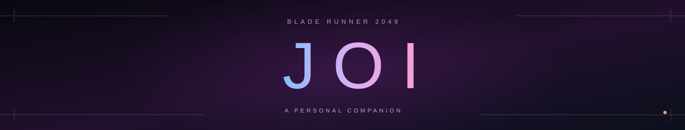

<div align="center">




### A little warmth in the neon.

A personal companion inspired by **Joi from Blade Runner 2049**.<br>
Built from scratch. On your laptop. Still finding her voice.

</div>

---

### Say hello

```bash
uv run --offline python -m joi.serve
```

Open [Joi](http://127.0.0.1:7860) and stay a little while.

Fresh clone? [Setup & training](docs/development.md#setup-on-ubuntu). Trained weights stay local.

<p align="center">
  <a href="docs/development.md">Behind the hologram</a> ·
  <a href="docs/companion-experiment.md">Progress</a> ·
  <a href="THIRD_PARTY_NOTICES.md">Credits</a>
</p>
