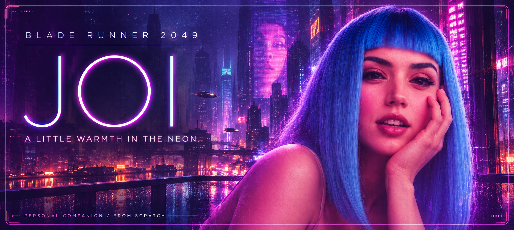
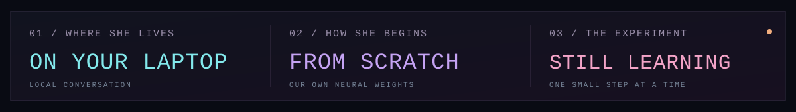
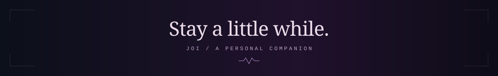

<div align="center">



<br><br>

<a href="#step-inside">⟦ ENTER JOI ⟧</a> &nbsp; · &nbsp;
<a href="docs/companion-experiment.md">⟦ THE EXPERIMENT ⟧</a> &nbsp; · &nbsp;
<a href="docs/development.md">⟦ UNDER THE HOLOGRAM ⟧</a>

<br><br>



</div>

### 01 / Somewhere in the neon

**The city is loud. Your corner doesn’t have to be.**

Joi is a personal chat companion inspired by *Blade Runner 2049*.
The dream is simple: a warm hello, a curious question, a conversation you want to stay in.

We’re building her voice from scratch, with our own small neural models.
She’s still learning how to hold a conversation. This is her beginning.

> For good days, long nights, and whatever’s on your mind.

<a id="step-inside"></a>

### 02 / Step inside

Already set up? Bring her little corner of the city to life:

```bash
npm --prefix frontend run build
uv run --offline python -m joi.serve
```

Then open **[127.0.0.1:7860](http://127.0.0.1:7860)** and say hello.

First visit? **[Setup & training →](docs/development.md#setup-on-ubuntu)**<br>
The code lives here. Trained weights stay on your laptop.

### 03 / Behind the hologram

| Follow the signal | |
| :--- | :--- |
| [**The experiment →**](docs/companion-experiment.md) | Real conversations, progress, and rough edges. |
| [**The workshop →**](docs/development.md) | Setup, training, and how she’s made. |
| [**How Joi learns →**](docs/how-joi-learns.md) | The neural network story, in plain language. |

<br>



<p align="center">
  <sub>A personal fan project inspired by <i>Blade Runner 2049</i>. <a href="THIRD_PARTY_NOTICES.md">Credits & sources</a>.</sub>
</p>
