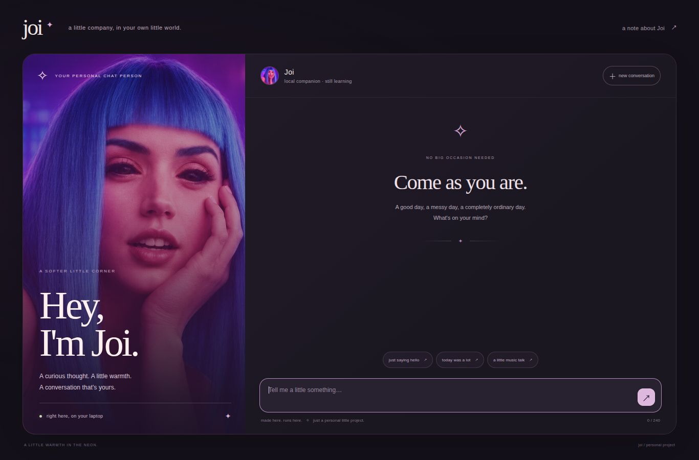
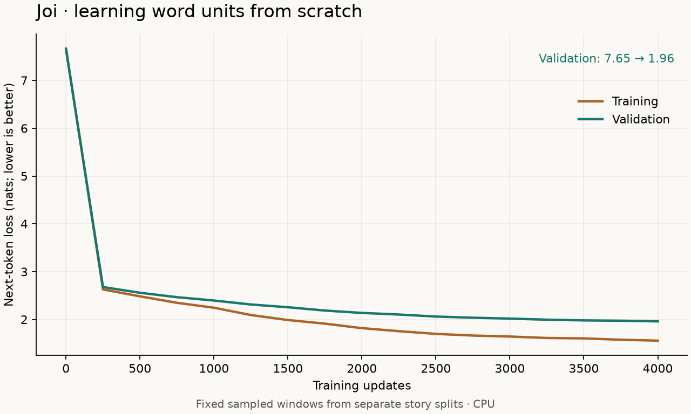

# Joi companion experiment: current status

The portrait, local app, neural inference, history handling, and training tools
are implemented. **The models do not yet reliably sustain a free-flowing
conversation.** Warm introductions and some familiar prompts work; topic
follow-ups, appropriate emotional responses, and name recall remain unreliable.
The software tests passing must not be confused with conversational competence.

## What you can use

```bash
uv run --offline python -m joi.serve
```

Open http://127.0.0.1:7860 from this laptop. The browser stores the transcript
locally. The model receives recent complete turns within its context window.
It does not learn permanently from chat messages. “New conversation” clears the
browser transcript. The app is served on loopback; it uses no external chat API.
A fresh clone needs environment setup and training, as described in the README.



[Phone layout](assets/joi-chat-mobile.jpg).

The portrait was edited from the owner's supplied image using built-in imagegen:
face-centered crop, foreground distractions removed, violet/blue/magenta lighting
preserved, clarity enhanced. [Portrait](../assets/joi-portrait.png) and
[exact edit prompt](../assets/joi-portrait.prompt.txt). The source attachment was
not overwritten.

## Strictly our own weights

No third-party pretrained model or tokenizer weights were used. The earlier
character model traces back to random initialization. The new word model was
also initialized from random weights and uses an original vocabulary fitted
only on training text. Subsequent tuning starts from our own checkpoints.

The selected general model has **691,712 parameters**, two transformer layers,
four attention heads, a 256-token context and a 2,048-piece vocabulary. Frequent
words are units; unfamiliar words use ASCII character fallback. Spaces are
separate tokens. This is a simple word/character tokenizer, not BPE.

A separately trained recall model is loaded when its compatible local checkpoint
exists. A small rule recognizes explicit name questions following a supported
self-introduction. If the name is not a known whole-word vocabulary entry, it
selects the neural recall model. Other messages use the general model. The router
selects a model; it does not compose or substitute a name answer. Both models
have 691,712 parameters. Use `--no-recall-specialist` for the general model alone.

## Training and data

The original DailyDialog archive was verified against its pinned SHA-256.
Official train/validation boundaries were retained, exact complete conversations
were deduplicated, punctuation was normalized, and the official test split was
not used. [Sources, attribution and license](../THIRD_PARTY_NOTICES.md).

The final word corpus has 8,088 unique training conversations and 279 validation
conversations. The weighted training set contains 10,640 conversations because
original Joi examples are intentionally repeated for style. Training text has
4,025,405 characters / 2,000,347 learned tokens; validation has 118,778 characters /
61,592 learned tokens. The vocabulary sees training text only.

| Stage | Budget | What happened |
| --- | --- | --- |
| Character dialogue | 800 updates, then 1,600 with faster CPU attention | Better character prediction; replies still mangled and recall failed |
| New word model | 4,000 updates from random weights | More recognizable words and warm phrases; familiar-name recall worked in one development example |
| Whole-transcript personality curriculum | 1,200 updates | Warm templates became stronger, but invented names intruded into unrelated replies; not selected as general chat |
| Weighted assistant-only recall | 1,200 updates; best weighted validation checkpoint at 1,000 | Improved the narrow unseen-name task; hurt ordinary chat, so retained only as a specialist |
| General assistant-only dialogue | 1,600 updates | Selected for everyday chat; coherent introductions, but follow-ups still often lose the topic |

The word model's fixed-window validation loss fell from 7.6536 to 1.9597 nats
per learned token. General assistant-only validation loss fell from 2.2727 to
2.2137 under its separate reply-target protocol. These are different objectives.
**Word-token loss cannot be numerically compared with character-token loss.**
The different corpora also prevent treating all stage scores as one learning curve.



CPU-only training used two threads on the development laptop. Recorded times
for the stages above were about 500 + 501 + 888 + 156 + 132 + 343 seconds,
respectively, excluding setup, development, tests and separate inference checks.
Timing varies with other work on the laptop. The attention-only dropout setting
was set to zero to use a faster CPU path; other model dropout remains 0.1.

## What generated conversations actually show

The selected general model produced this response to `Hi Joi, how are you?`:

> Hey, you! I'm glad you're here. How has your day been?

It also responded to an Arnav introduction and later returned Arnav correctly.
However, the development probes still fail an unfamiliar name and a topic-recall
question. It can provide an inappropriate follow-up to a tired-day message or
change to an unrelated subject. During browser QA, after an introduction followed
by `I had a tiring day.`, one reply was:

> That sounds wonderful. What do you like to draw?

That is an actual failure, not an acceptable result for the intended companion.
More language training, data quality work and capacity experiments are needed.
We have not established consistently cheerful, relevant dialogue.

- [Selected general model: all development conversations](../evaluation/companion-general.json)
- [Routed app: all development conversations and model choices](../evaluation/companion-runtime.json)
- [Earlier character-model outputs](../evaluation/companion-character-final.json)
- [Whole-transcript personality attempt](../evaluation/companion-persona-full-lm.json)

These are development probes, not an independent test set. Later turns use the
model's own generated replies. Whole-word name matching is used; `Neell` does
not count for `Neel`. No failed samples were replaced with scripted answers.

## Unseen-name recall

Each row uses the same 20 synthetic validation names and familiar question
formats. The names are absent from training text. Both replies are generated;
a correct reference greeting is not fed to the model. The fixed protocol uses
48 new tokens per reply, temperature 0.65, top-k 15, and six-token repetition
blocking. A name counts only if it appears as a complete word in the final reply.

| Model / runtime | Exact names recalled |
| --- | ---: |
| General word model before tuning | 0 / 20 |
| General assistant-tuned model | 0 / 20 |
| Focused recall model | 10 / 20 |
| App routing: general greeting, then recall model when applicable | 7 / 20 |

The routed score is lower than the specialist-only score because the preceding
greeting comes from a different model, changing the later context. This exposes
history sensitivity rather than a reliable memory feature. These numbers do not
establish recall on unrestricted messages, other names or longer histories.

- [Word-model trials](../evaluation/recall-word.json)
- [General-model trials](../evaluation/recall-general.json)
- [Recall-specialist trials](../evaluation/recall-specialist.json)
- [Routed-runtime trials](../evaluation/recall-runtime.json)

Earlier reports explicitly marked `before-decoder-fix` retain their original
three-token blocking setting and outputs. That setting was too aggressive for
this vocabulary: a space/word/space triple could suppress a legitimate repeated
word. Current chat uses six raw tokens, roughly three words, and can complete
phrases such as “something gentle to do?” naturally. Prompt tokens are excluded
from repetition blocking, allowing a supplied name to be copied.

## Verification

All 29 automated tests passed, covering causal masking, learning, checkpoint
roundtrips and legacy loading, exact resume behavior, vocabulary fallback,
context budgeting, supervised target masking and cropping, real generated-history
probes, synthetic-name separation, whole-name matching, routing, API behavior,
and turn boundaries. The browser was checked at desktop and phone sizes; sending,
reload persistence, reset, model notes, and recoverable input errors were exercised.

The app and neural pipeline work. The next quality milestone is relevance and
stable topic-following across multiple turns, evaluated on conversations outside
the authored training scenarios. The current models are a research prototype;
reliable companion behavior has not yet been achieved.
