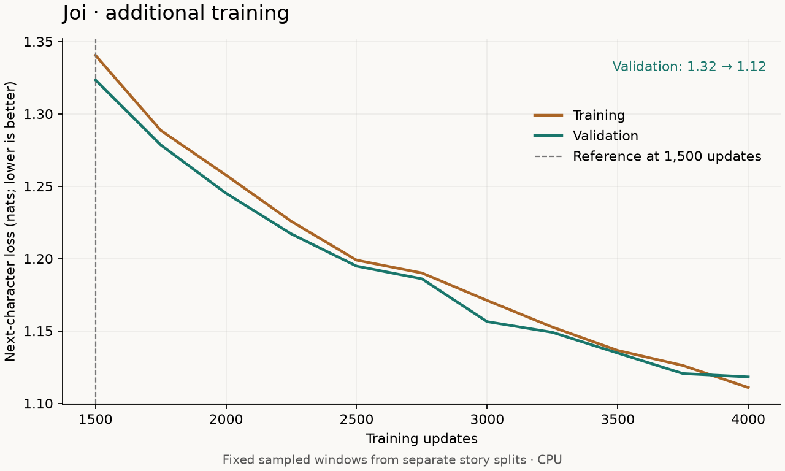

# Longer training: v1 versus 4,000 updates

Continuing the same tiny model improved matched validation loss by
**16.70%**, from
**1.3409 to 1.1169 nats per character**.
The samples contain more recognizable phrases, but grammar, story consistency,
and replies to user questions remain unreliable. This is progress in character
prediction; it is not a working conversational assistant yet.

## What changed

Only the training budget changed: we continued from 1,500 to 4,000 total updates.
The 425,472-parameter architecture, data, optimizer settings, batch size, seed,
and two CPU threads stayed fixed. The original `checkpoints/v1/` was preserved;
the continued run lives in `checkpoints/v1-longer/`.

Evaluation/checkpoint frequency changed from every 100 updates to every 250
for the continued run. Evaluation uses its own fixed sampler and disables
dropout, so it does not change the training random-number sequence.

The extra 2,500 updates took **596.2 recorded seconds** (about 9 minutes
56 seconds). Total recorded training/evaluation time across both stages was
990.2 seconds, about 16 minutes 30 seconds. These figures
exclude setup, pauses between stages, tests, and the separate final comparison.
They depend on hardware and competing workloads.

## Matched comparison

Both models were scored on the same 32 batches of 16 validation windows, each
128 characters long, using seed 123. This is 65,536 sampled prediction positions,
including possible overlaps. Neither score is a full-validation-corpus score.

| Measure | v1: 1,500 updates | Continued: 4,000 updates |
| --- | ---: | ---: |
| Matched validation loss, nats/character | 1.3409 | 1.1169 |
| Character perplexity | 3.8224 | 3.0555 |
| Training-loop training loss | 1.3404 | 1.1109 |
| Training-loop validation loss | 1.3234 | 1.1183 |

The loop uses eight fixed batches per split with its original seeds. Its
validation score therefore differs slightly from the separate matched score.
The best loop checkpoint occurred at step 4,000. The close training and validation
losses do not show a large generalization gap on these particular sampled windows.
We have not established the same behavior on other datasets or a separate test set.



[Full learning curve from random initialization](assets/v1-longer-loss.png).

## Sample review

The [comparison JSON](../evaluation/v1-longer-comparison.json) contains all four
baseline and candidate continuations under identical prompts, temperature 0.8,
top-k 20, and seeds 123–126. Each continuation is 200 characters. No sample was
selected as a representative success while hiding the other outputs.

The longer run produces some cleaner fragments, such as “They played together.”,
but still invents words, changes characters unexpectedly, and forms broken
sentences. The greeting and comfort prompts still lead into unrelated story
text. A lower next-character loss has **not** established cheerful dialogue.
TinyStories supplies stories rather than examples of useful assistant replies.

## Tools added and verification

- `joi.compare` evaluates both checkpoints using identical windows and generation
  settings. It records dataset, vocabulary, model settings, checkpoint hashes,
  PyTorch version, and sample seeds. Incompatible protocols are rejected.
- Evaluation reads one checkpoint snapshot, so its hash still describes the
  evaluated weights if training replaces the file during evaluation.
- `joi.play` loads a model once for independent local prompt continuations. It
  handles unsupported text, help, exit, and end-of-input without changing weights.
- The plot command supports experiment titles, a reference update, and zooming
  in on later training.

All **nine automated tests passed**. The evaluator also exactly reproduced v1's
published loss and all four sample continuations using the actual v1 checkpoint.
Comparing v1 against itself gave zero loss change and identical samples. The
continued checkpoint was exercised in the offline terminal playground. The
rendered full and close-up learning curves were inspected.

## Try it locally

From the repository root:

```bash
uv run --offline python -m joi.play --checkpoint checkpoints/v1-longer/best.pt
```

Start with a story prompt such as `Once upon a time`, and use `/quit` to exit.
Each prompt starts independently; earlier prompts are not conversation history.
The original command defaults continue to select v1 unless you supply the
continued checkpoint explicitly.

Recreate the continued experiment and run the comparison:

```bash
cp -a checkpoints/v1 checkpoints/v1-longer
uv run --offline python -m joi.train --resume checkpoints/v1-longer/last.pt --out checkpoints/v1-longer --steps 4000 --eval-every 250
uv run --offline python -m joi.compare --baseline checkpoints/v1/best.pt --candidate checkpoints/v1-longer/best.pt --out runs/v1-longer-comparison.json
```

The copy requires a fresh destination and an existing completed v1 run. See the
[README](../README.md) for environment setup and training v1 from random weights.
The datasets and trained checkpoints remain local; code, summaries, plots, and
[metrics](../evaluation/v1-longer-metrics.csv) are tracked in Git.

## Next experiment

Longer training helped basic language prediction, while the prompt review still
shows a mismatch between story training and the goal of cheerful conversation.
A next experiment should prepare licensed dialogue examples with explicit user
and assistant boundaries, preserve an independent validation set, and test
whether this small model and its short context can learn that format. Fluent,
useful dialogue remains an experiment to evaluate rather than a promised outcome.
