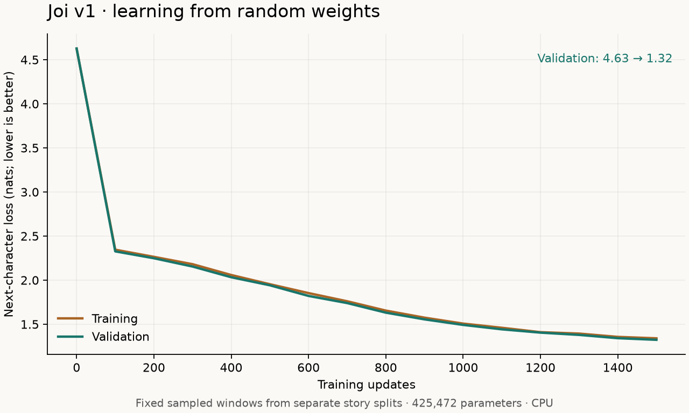

# Joi v1: first CPU baseline

This run establishes a working training and generation pipeline. Joi learned
character patterns from random weights; its samples still contain invented
words, broken grammar, and unrelated story fragments. The greeting and comfort
samples do not demonstrate reliable conversation or a consistent cheerful style.

## Experiment

- Hardware: Intel Core i5-11300H, CPU only, two PyTorch threads.
- Environment: Python 3.12.15, PyTorch 2.15.0+cpu, locked dependencies in `uv.lock`.
- Architecture: 425,472 parameters; 2 transformer layers; 4 heads; embedding
  width 128; context 128 characters; dropout 0.1; 96-character ASCII vocabulary.
- Data: deterministic prefixes of TinyStories, revision
  `f54c09fd23315a6f9c86f9dc80f725de7d8f9c64`.
- Splits: 2,316 training stories / 2,060,368 characters; 301 validation stories /
  257,794 characters. Exact normalized story overlap was removed and checked.
- Training: AdamW; learning rate 0.001; weight decay 0.01; gradient clipping 1.0;
  batch size 16; seed 42; 1,500 updates, about 3.07 million sampled target
  character positions including overlaps and repeats.
- The run was saved at step 100 and resumed to step 1,500. Resume restores
  weights, optimizer state, dropout randomness, and the training sampler.

## Measured results

| Metric | Before training | At step 1,500 |
| --- | ---: | ---: |
| Training loss, nats per character | 4.6266 | 1.3404 |
| Training-loop validation loss, nats per character | 4.6275 | 1.3234 |

The recorded training/evaluation time was **394.0 seconds**
(about 6 minutes 34 seconds). This excludes environment setup, dataset download,
code development, tests, the pause between the initial timing run and resume,
and the separate final evaluation. Hardware load affects future timings.

The curve uses 8 batches of 16 windows per split at each evaluation. Each window
has 128 target positions, and the sampled windows stay fixed across updates.
The lowest measured loop validation loss occurred at step 1,500, so `best.pt`
and `last.pt` contain the same final model weights.

A separate evaluation with seed 123 and 32 batches of 16 validation windows
measured **1.3409 nats per character** and
**3.8224 character perplexity**. This uses 65,536
sampled prediction positions, which can overlap; it is not a full-corpus score.
Its different samples explain the small difference from the training-loop score.
These character-level scores should not be compared directly with subword-token
scores from other models.

## Sample review

Four fixed prompts and their exact 200-character continuations, including errors,
are recorded in [the evaluation output](../evaluation/v1-results.json). They use
temperature 0.8, top-k 20, and seeds 123 through 126. The prompts cover story
continuation, friendship, comfort, and a greeting. They are evaluation inputs,
not examples of target responses supplied during training.

Manual review: recognizable English words and story-like fragments appear,
but sentences are often ungrammatical, invented words remain, and responses
frequently drift away from the prompt. Cheerfulness and coherent dialogue
are **not established** by this run. The dataset teaches story continuation;
a dialogue-specific dataset and further experiments will be needed for chat.

## Verification and reproduction

All six automated tests passed: tokenizer behavior, causal attention, learning a
simple sequence, split deduplication, offline checkpoint loading/generation, and
an uninterrupted-versus-resumed training comparison with dropout. The latter
produced identical model tensors and random-number states in the same CPU
environment. Offline generation was also run using the actual trained checkpoint.

The training code, dataset revision, hashes, model config, and dependencies are
recorded. See [the README](../README.md) for setup, training, resume, evaluation,
and generation commands. Timing itself is not deterministic across workloads.

- [Training metrics](../evaluation/v1-metrics.csv)
- [Final evaluation and generated samples](../evaluation/v1-results.json)
- [Dataset source and license](../THIRD_PARTY_NOTICES.md)

Checkpoints and downloaded data remain local in ignored directories; this
repository contains code and experiment summaries. A fresh clone must prepare
the data and train before generating with its own weights.
